# PVE Manager

[](https://github.com/MajorMaxdom/PVEManager/actions/workflows/ci.yml)
[](LICENSE)

A self-hosted web UI to manage **several standalone Proxmox VE hosts from one place**: live overview, power control,
in-browser consoles, backups and restores, updates, schedules and alerts. One static Go binary with the UI embedded,
SQLite for storage, no cloud and no agents on your hosts: it talks to the regular PVE API with a least-privilege token.

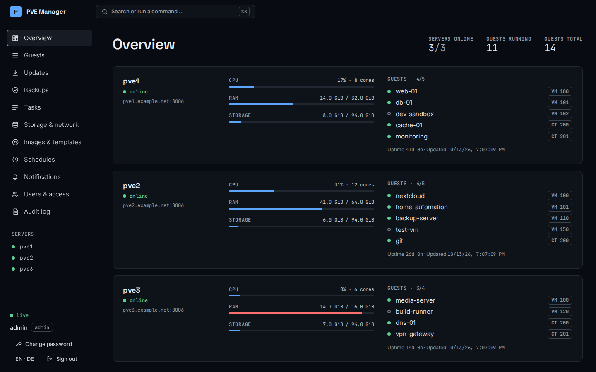

> The screenshots show made-up demo data. You can run the same demo yourself without any Proxmox server:
> `make demo` (see [Try it](#try-it-without-proxmox)).

## Features

- **Overview** of all hosts and guests with live updates; filters, search, bulk actions, ⌘K command palette
- **Power and consoles**: start, shut down, reboot, force stop (with confirmation); VM display (VNC) and container console
- **Create and manage guests**: new VMs and containers, clone, delete (typed-name confirmation), templates, cloud-init, snapshots
- **Graphs** per guest for CPU, memory, network and disk I/O (1 h / 24 h / 7 d)
- **Backups**: age per guest at a glance, guests without a backup, backup now, restore as a **new** guest or over the old one
- **Updates**: pending packages per host; optional upgrade over a tightly restricted SSH account with a live log
- **Tasks**: history of all hosts with logs. **Storage, disks (SMART, wear) and network** overview
- **Images and templates**: streamed upload, download by URL, template catalogue
- **Schedules** (cron) and **alerts** to ntfy, webhook, Telegram or e-mail
- **Access**: users with roles (viewer, operator, admin), API keys, optional **OpenID Connect** single sign-on, audit log
- **Prometheus** metrics, encrypted **backup of the manager itself**, German and English UI

<details>
<summary>More screenshots</summary>

| | |
|---|---|
| 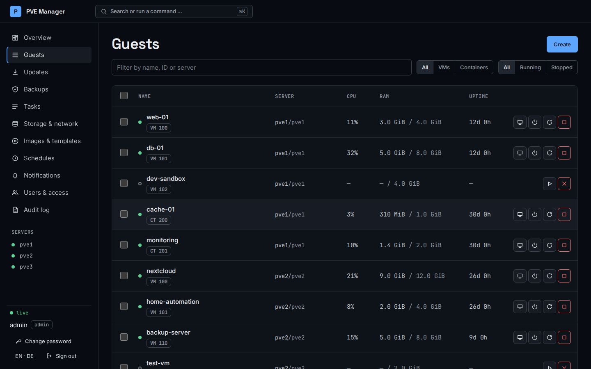 | 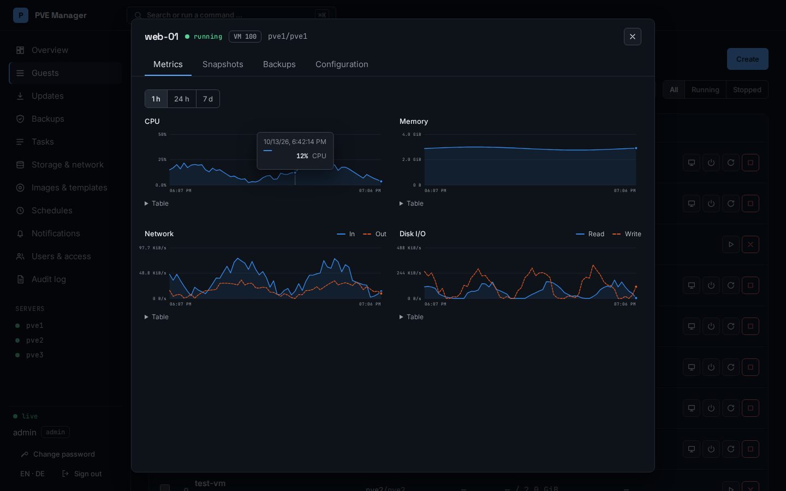 |
| 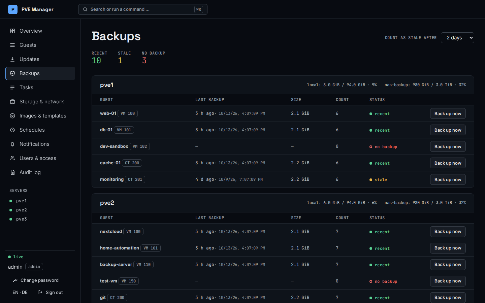 | 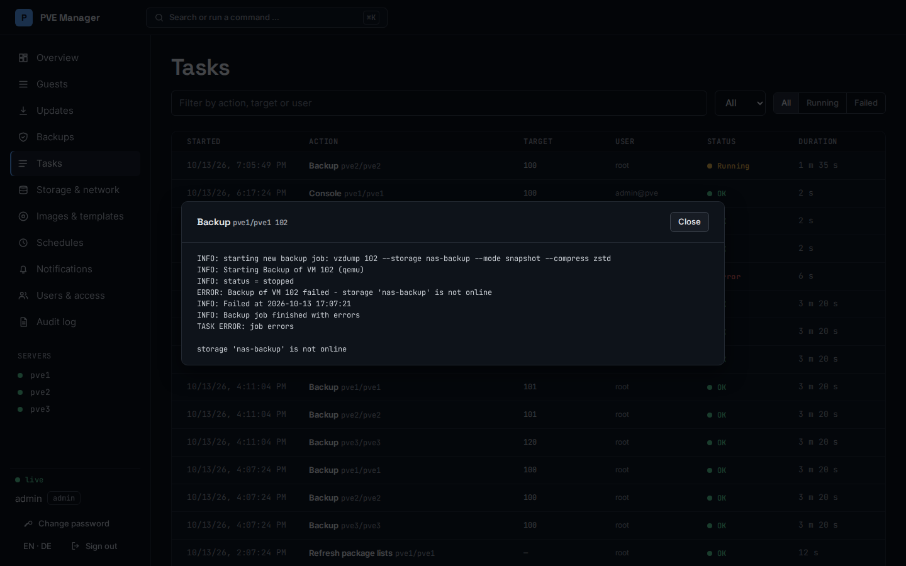 |
| 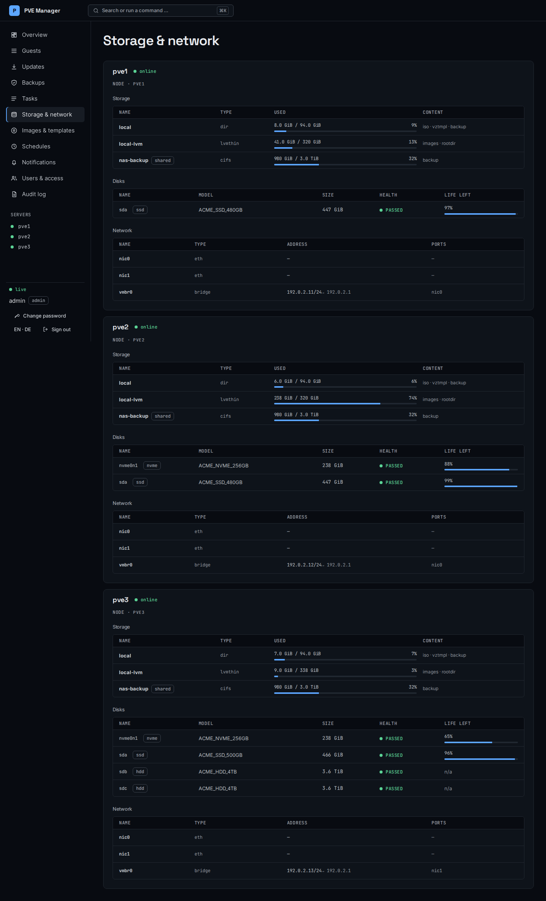 | 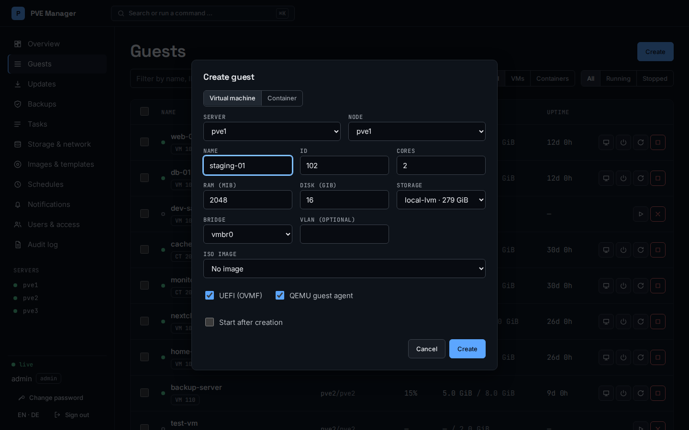 |
| 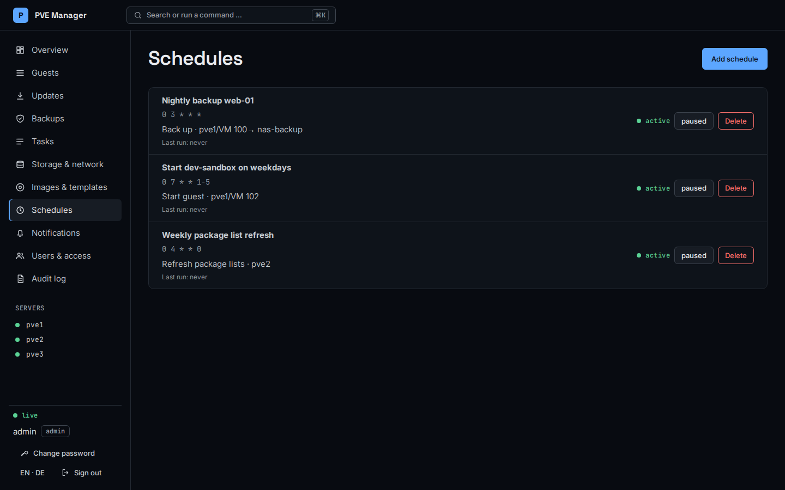 | 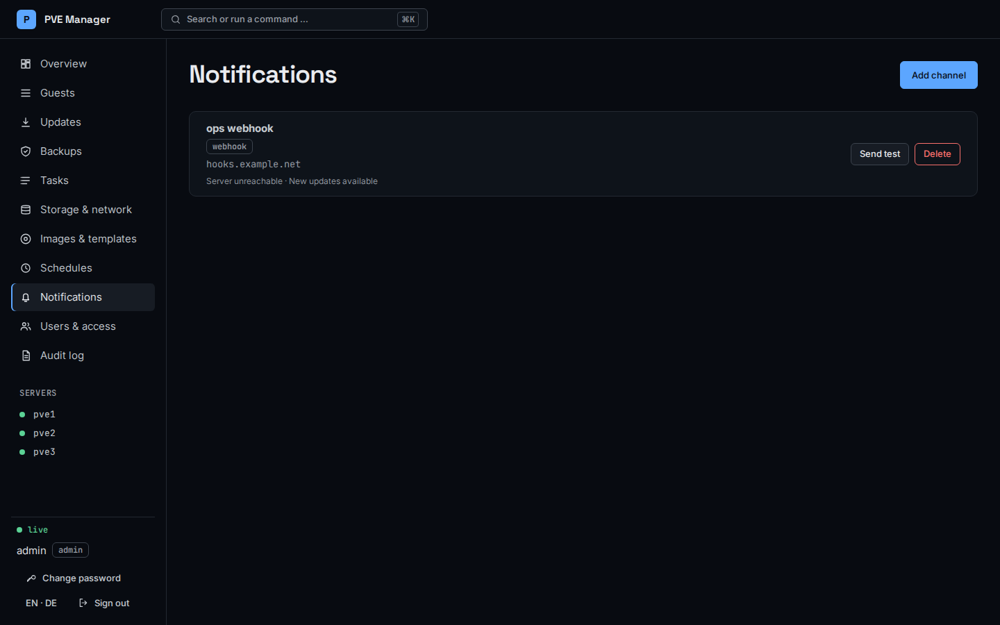 |
| 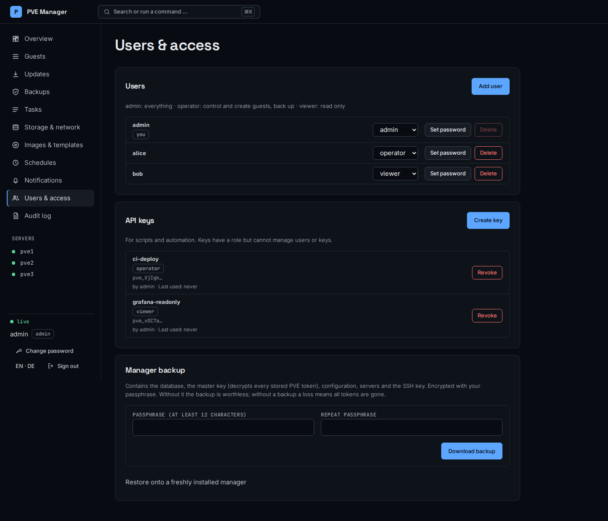 | 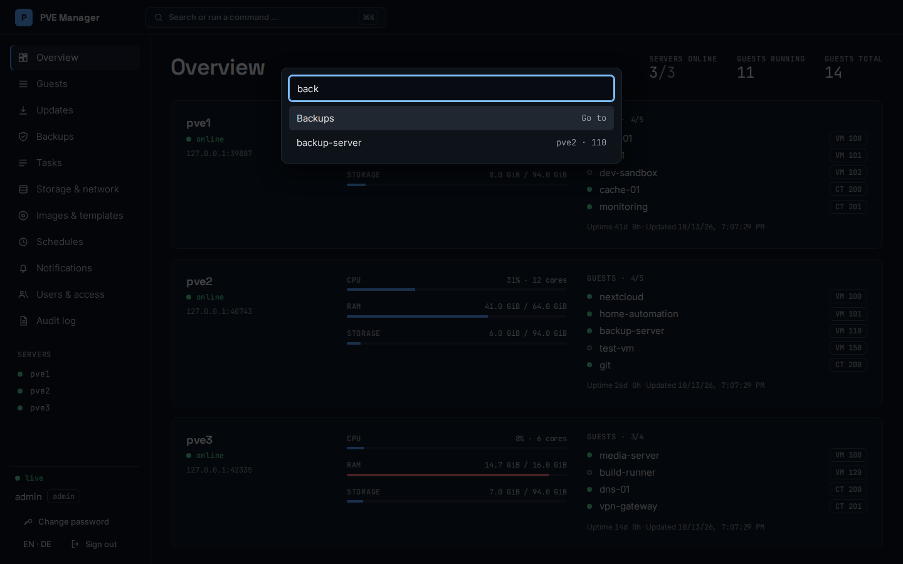 |

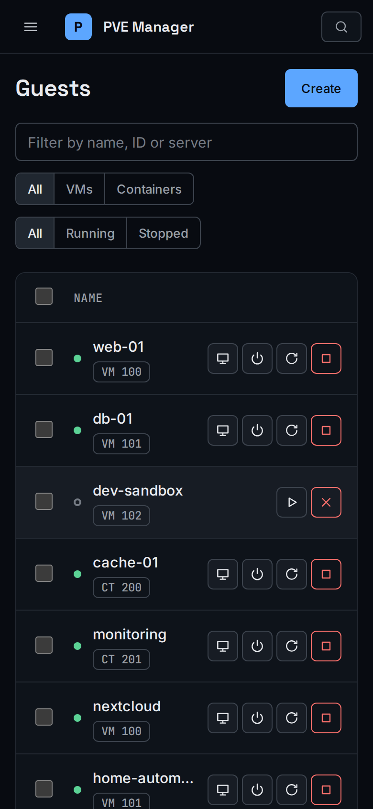 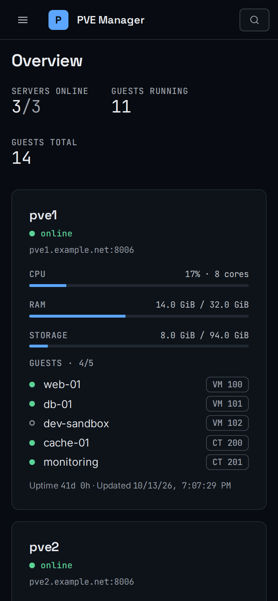

</details>

## Install

Requirements: a Linux host with systemd that can reach the PVE API (port 8006) of your hosts; amd64 or arm64.
Download from the [releases](https://github.com/MajorMaxdom/PVEManager/releases):

```
curl -LO https://github.com/MajorMaxdom/PVEManager/releases/latest/download/pve-manager-linux-amd64
curl -LO https://github.com/MajorMaxdom/PVEManager/releases/latest/download/pve-manager-deploy.tar.gz
tar xzf pve-manager-deploy.tar.gz
sudo ./install.sh --binary ./pve-manager-linux-amd64                 # interactive
sudo ./install.sh --binary ./pve-manager-linux-amd64 --config install.conf   # unattended, see install.example.conf
```

The installer asks for the listen address (default `0.0.0.0:8443`), host name, TLS mode (self-signed, your own files, or
off behind a reverse proxy), the admin user and optional server definitions. It creates the `pvemanager` service user, a
hardened systemd unit and a master key, and prints a generated admin password once. Running it again upgrades the binary and
keeps config, data, key and accounts. Build from source instead: `make all` (needs Go and Node.js 24).

## Connect a Proxmox host

On a machine with SSH access to the PVE host:

```
deploy/onboard-pve-host.sh pve1.example.net                       # role + user + API token, writes servers.d/pve1.yaml
deploy/onboard-pve-host.sh pve1.example.net --with-updates --pubkey /etc/pve-manager/ssh/id_ed25519.pub
sudo pve-manager server add -file servers.d/pve1.yaml -config /etc/pve-manager/config.yaml
```

The script creates the role `ManagerSvc`, the user `pvemanager@pve` and an API token, and records the host's TLS
fingerprint (connections are pinned to it). `--with-updates` additionally creates a restricted SSH user for package upgrades.
Other options: `--update-role` (after upgrading the manager), `--rotate` (new token), `--revoke` (remove everything),
`--dry-run`. Details and the exact privileges: [docs/security.md](docs/security.md).

## Try it without Proxmox

```
make demo          # three mock hosts with made-up guests; opens on a random local port, login admin / demo-password-123
make screenshots   # regenerates docs/screenshots from the demo
```

## Configuration

`/etc/pve-manager/config.yaml` (written by the installer):

| Key | Meaning |
|---|---|
| `listen` | address and port, default `0.0.0.0:8443` |
| `hostname` | name used in the self-signed certificate |
| `tls.mode` | `selfsigned`, `files` (with `tls.cert`, `tls.key`) or `off` (behind a reverse proxy) |
| `data_dir`, `secret_file`, `servers_dir` | database directory, master key, server definitions |
| `ssh_key_file` | private key for the optional host upgrades |
| `metrics_token_file` | enables `/metrics` when set |
| `oidc.*` | optional single sign-on, see below |

### Users, API keys and single sign-on

Users and roles are managed under *Users & access*. API keys are bearer tokens for scripts:

```
curl -k -H "Authorization: Bearer pvm_…" https://manager.example.net:8443/api/state
```

A key carries a role but can never manage users or keys; that needs a browser session.

OpenID Connect is off by default:

```yaml
oidc:
  issuer: https://auth.example.com/application/o/pve-manager/
  client_id: pve-manager
  client_secret_file: /etc/pve-manager/oidc.secret      # chmod 0640 root:pvemanager
  redirect_url: https://manager.example.net:8443/api/oidc/callback   # register exactly this at the IdP
  admin_group: pve-admins        # highest matching group wins: admin > operator > viewer
  operator_group: pve-operators
  viewer_group: pve-viewers
  default_role: none             # none = users in no mapped group are denied
  button_label: "Sign in with SSO"
```

Open the manager under the host name of `redirect_url`: the login state cookie is bound to it. SSO users are created at first
login, their role follows the groups at every login, and they cannot use password login.

### Prometheus

The installer creates `/etc/pve-manager/metrics.token` and enables `/metrics` (skip with `--no-metrics`):

```yaml
scrape_configs:
  - job_name: pve-manager
    scheme: https
    tls_config: { insecure_skip_verify: true }   # self-signed; or set ca_file to /var/lib/pve-manager/tls.crt
    authorization: { credentials_file: /path/to/metrics.token }
    static_configs: [{ targets: ['manager.example.net:8443'] }]
```

Exposed: `pve_server_up`, `pve_node_*` (CPU, memory, rootfs, uptime), `pve_guest_*` (up, CPU, memory, uptime), `pve_storage_*`.

## Back up the manager

The manager holds the master key that decrypts every stored PVE token. Keep a backup, and keep the passphrase separately:

```
sudo pve-manager backup -out pve-manager-backup.pvmbak     # asks for a passphrase (12+ characters); works while the service runs
sudo systemctl stop pve-manager
sudo pve-manager restore -in pve-manager-backup.pvmbak      # -dry-run shows what would be written; -force replaces an existing install
sudo systemctl start pve-manager
```

The same archive can be downloaded in the browser (*Users & access → Manager backup*). It is encrypted (Argon2id +
AES-256-GCM) and contains the database, master key, config, server definitions, SSH key, metrics/OIDC secrets and the TLS
certificate. On a new host: run `install.sh`, stop the service, restore, start.

## Uninstall

```
sudo ./uninstall.sh              # removes service and binary; asks before deleting config and data
sudo ./uninstall.sh --purge      # also removes /etc/pve-manager, /var/lib/pve-manager and the service user
```

Your Proxmox hosts are never touched; revoke the access there with `onboard-pve-host.sh HOST --revoke`.

## Development

```
make test          # go vet + Go tests
make e2e           # browser tests (Playwright) against a mock PVE host and a mock OIDC provider
make demo          # the demo above
```

First run of the browser tests: `cd web/e2e && npm ci && npx playwright install chromium`. See
[CONTRIBUTING.md](CONTRIBUTING.md), the [security model](docs/security.md) and the [roadmap](docs/ROADMAP.md).

## License

[MIT](LICENSE)
